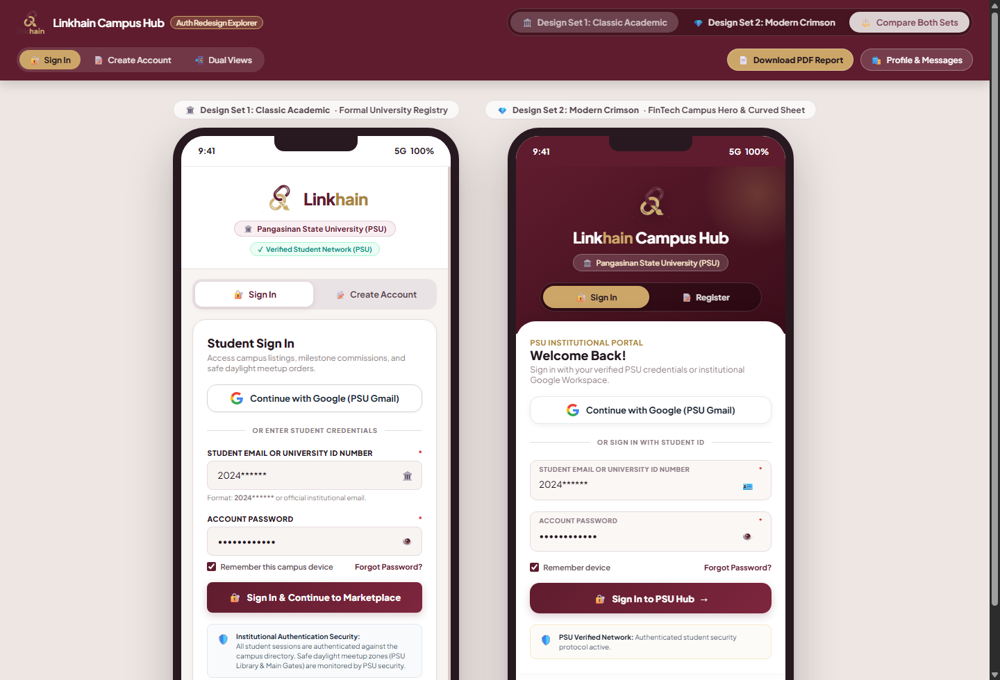
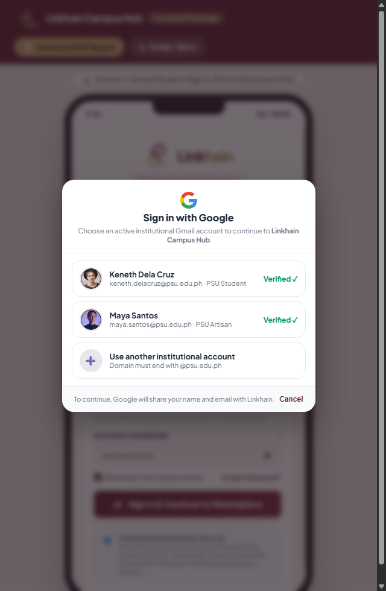
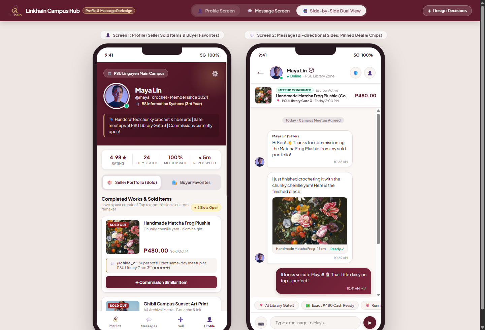
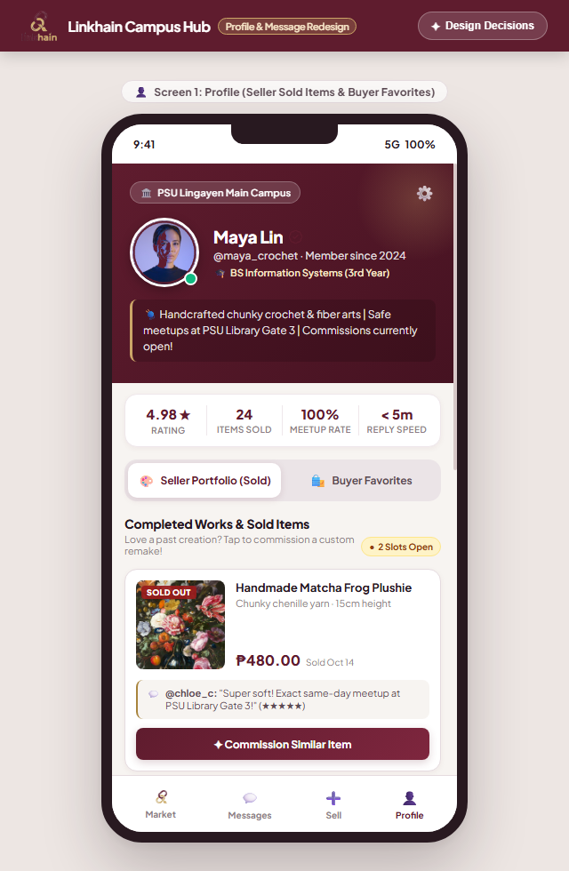
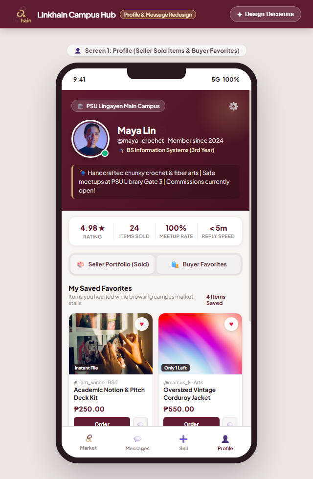
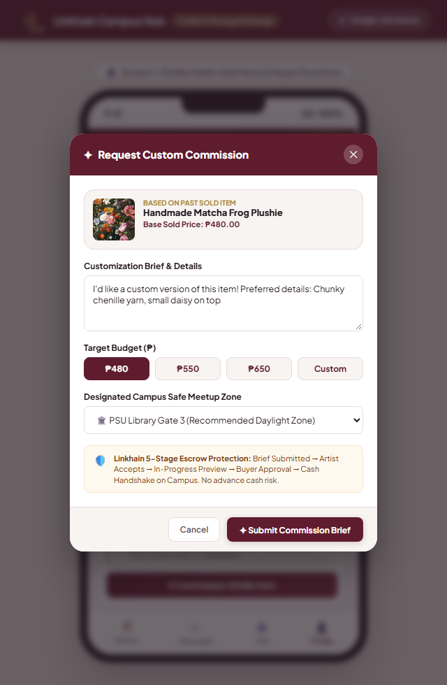
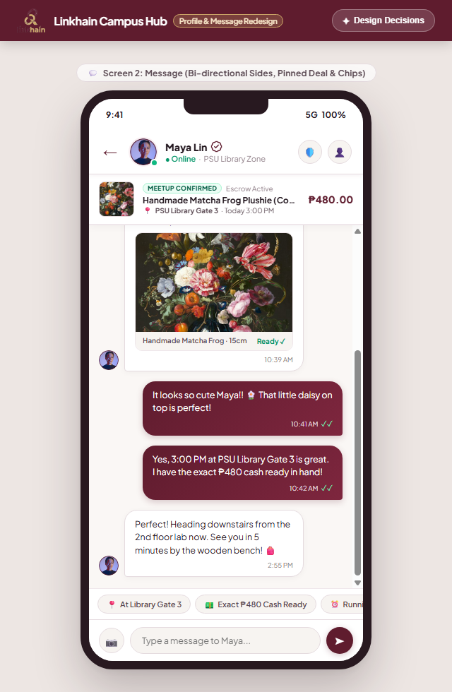

# Linkhain Campus Hub · Mobile UI Redesign Specification

**CC313 Midterm Project Deliverable · Pampanga State University (PSU)**  
Author: Keneth ([@cutiekyee](https://github.com/cutiekyee))

---

## 🌐 Public Live Links (Available Instantly in Any Web Browser)

| Prototype / Deliverable | Direct Live Web Link | Highlights & Features |
| :--- | :--- | :--- |
| 🔐 **Login & Register Portal** | [**https://cutiekyee.github.io/linkhain-ui/auth.html**](https://cutiekyee.github.io/linkhain-ui/auth.html) | • **Design Set 1: Classic Academic** (Clean white university card) • **Design Set 2: Modern Crimson** (Deep maroon curved sheet) • **Side-by-Side Comparison Mode** • `2024******` ID format & PSU Gmail Sign-in • Demo logins & security box removed |
| 🛍️ **Marketplace, Profile & Chat** | [**https://cutiekyee.github.io/linkhain-ui/**](https://cutiekyee.github.io/linkhain-ui/) | • **Seller Sold Portfolio** with `[ ✦ Commission Similar Item ]` • **Buyer Wishlist** of saved favorite listings • **Bi-Directional Speech Bubbles** (Seller on left, Buyer on right) • Sticky transaction terms & campus meetup quick-chips |
| 📑 **Full Specification Report (HTML)** | [**https://cutiekyee.github.io/linkhain-ui/report.html**](https://cutiekyee.github.io/linkhain-ui/report.html) | • Complete 8-section technical specification document • Embedded high-resolution diagrams & token tables • Viewable in any mobile or desktop web browser |
| 📄 **Download Official PDF Report** | [**Download PDF (1.5 MB)**](https://cutiekyee.github.io/linkhain-ui/Linkhain_Profile_Message_Redesign_Report.pdf) | • Official 8-page print-ready technical submission • Pampanga State University (PSU) header & verification |

---

## 📱 Visual Highlights

### 1. Minimalist Authentication & Registration (Two Design Sets)
- **Minimalist Vector Mark**: Crisp interlocking loop emblem replacing heavy textures.
- **Pampanga State University (PSU)**: Standardized institutional branding without "SSO".
- **Google / Institutional PSU Gmail**: Authentic `@psu.edu.ph` account chooser modal.
- **Removed Demo Logins**: No test buttons, no bypass, pure institutional layout.

### 2. Google Workspace Institutional Account Chooser

### 3. Profile & Bi-Directional Message Screen Suite
- **Seller Mode**: Showcases completed sales with "SOLD OUT" badges and the **`[ ✦ Commission Similar Item ]`** modal trigger.
- **Buyer Mode**: Displays bookmarked marketplace items with active red heart toggles and instant campus meetup ordering.
- **Bi-Directional Message Screen**: Distinct left (seller card) and right (buyer crimson) speech bubbles with sticky transaction card.

  
  
  
  

