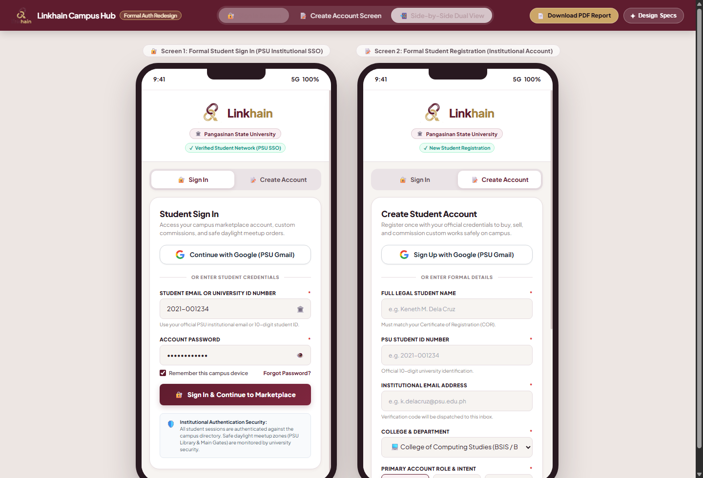

# Linkhain Campus Hub · Mobile UI Redesign Specification

**CC313 Midterm Project Deliverable · Pampanga State University**  
Author: Keneth ([@cutiekyee](https://github.com/cutiekyee))

## 🌐 Live Interactive Prototypes (Public Web Access)
* 🔐 **[Formal Login & Create Account Portal](https://cutiekyee.github.io/linkhain-ui/auth.html)**  
  *(Formal institutional fields, PSU Gmail / Google SSO login, demo logins completely removed)*
* 🛍️ **[Profile & Message Screen Prototype](https://cutiekyee.github.io/linkhain-ui/)**  
  *(Seller sold items with commission CTA, buyer favorites wishlist, bi-directional chat)*
* 📄 **[Download 8-Page PDF Specification Report](./Linkhain_Profile_Message_Redesign_Report.pdf)**

---

## 📱 Visual Highlights

### 1. Formal Authentication & Registration (Sign In & Create Account)
- **Institutional Context**: Formal PSU SSO authentication, Department dropdowns, student ID examples.
- **Google / Institutional Gmail**: One-tap authentication with active `@psu.edu.ph` accounts.
- **Demo Logins Removed**: Clean, production-ready, institutional layout.

### 2. Google Workspace Account Picker

### 3. Profile & Message Screen Suite

- **Seller Mode**: Showcases completed sales with "SOLD OUT" badges and the **`[ ✦ Commission Similar Item ]`** CTA button.
- **Buyer Mode**: Displays bookmarked marketplace items with active red heart toggles and instant campus meetup ordering.
- **Bi-Directional Message Screen**: Distinct left (seller) and right (buyer) speech bubbles with sticky transaction card.

  
  
  

